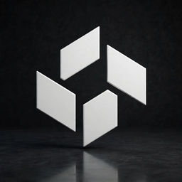
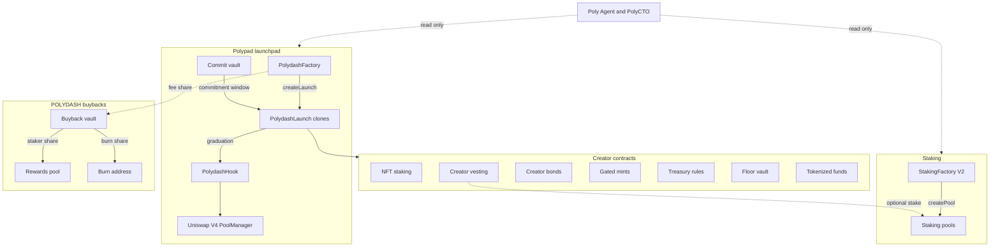

<p align="center">
  
</p>

<h1 align="center">Polydash</h1>

<p align="center">
  Polydash builds Polypad, a token launchpad on Robinhood Chain (chain ID 4663), with staking pools, creator contracts, and read-only AI agents.
</p>

<p align="center">
  <a href="https://github.com/polydash-labs/Polydash/actions/workflows/ci.yml"></a>
  <a href="https://heyresearch.xyz"></a>
  <a href="LICENSE"></a>
  
  <a href="https://getfoundry.sh"></a>
</p>

<p align="center">
  <a href="https://polypad.family">Polypad</a> ·
  <a href="docs/README.md">Docs</a> ·
  <a href="https://dasheco.xyz">Website</a> ·
  <a href="https://x.com/Polydash_">X @Polydash_</a> ·
  <a href="https://t.me/polydashofficial">Telegram</a> ·
  <a href="https://polypad.family/contracts">Contracts</a> ·
  <a href="https://polypad.family/brand">Brand kit</a>
</p>

<p align="center"></p>

Polypad ([polypad.family](https://polypad.family)) is the launchpad. The company site is [dasheco.xyz](https://dasheco.xyz). This repository is the source for the staking contracts, the Polypad creator contracts, the launchpad package, and the Poly Agent and PolyCTO code.

Projects that launch on Polypad go through [@Bevor_io](https://x.com/Bevor_io) pre-launch checks and have a doxxed lead. The on-chain `createLaunch` call itself is permissionless. See [docs/AGENTS_LAUNCH.md](docs/AGENTS_LAUNCH.md).

The contracts in this repository are **unaudited**. An outside review is planned. Verification on Sourcify and the automated scans in CI are not a review.

## Architecture



Staking v1 behaviour, roles, and fees are written up in [docs/ARCHITECTURE.md](docs/ARCHITECTURE.md). Creator-module design is in [docs/CREATOR_CONTRACTS.md](docs/CREATOR_CONTRACTS.md). Launchpad design is in [polypad/contracts/docs/ARCHITECTURE.md](polypad/contracts/docs/ARCHITECTURE.md).

## Features and modules

| Area | What it does | Where |
| --- | --- | --- |
| Polypad launchpad | Commitment window, bonding curve, graduation into a Uniswap V4 pool. Current creator fee cap is 5%. An earlier factory used a 2% cap; its launches stay listed. | [`polypad/`](polypad) |
| Staking V2 | Permissionless reward pools. Creator-chosen claim fee of 1–5%, of which 30% goes to the platform. Reward math uses 1e36 scaling with a carried remainder. | [`src/v2/`](src/v2) |
| Staking V1 | Legacy factory. Do not use it for new pools. | [`src/PolydashStakingFactory.sol`](src/PolydashStakingFactory.sol) |
| NFT staking | Stake ERC-721s for an ERC-20 reward over a fixed window, with optional loyalty and set boosts. | [`src/nftstaking/`](src/nftstaking) |
| Creator vesting | Ownerless cliff and linear vesting. A vault can stake locked tokens in a V2 pool. | [`src/vesting/`](src/vesting) |
| Creator bonds | ETH bond that a launch creator posts against a floor token balance. | [`src/bond/`](src/bond) |
| Gated mints | NFT collections with an optional token-holder phase. | [`src/gatedmint/`](src/gatedmint) |
| Treasury rules | Per-token treasury. Operator tasks run only inside published rules and a timelock. | [`src/treasury/`](src/treasury) |
| Floor vault | Fixed-price NFT collections whose mint share funds an ETH and launch-token vault. | [`src/floorvault/`](src/floorvault) |
| Tokenized funds | Phase 1a raise: fixed-price ERC-721 units, ETH held in a vault, no principal withdraw. | [`src/fund/`](src/fund) |
| Buybacks | Capped POLYDASH buys from a fee share: 62.5% burned, 37.5% to stakers. | [`src/buyback/`](src/buyback) |
| Poly Agent | Read-only staking monitor: pool sizes, reward rates, inflows and outflows. | [`agents/poly-agent/`](agents/poly-agent) |
| PolyCTO | Read-only multi-role agent for a launch: community, marketing drafts, token stats, and a heuristic source scan. The scan is not a review. | [`agents/polycto/`](agents/polycto) |
| Agent launch API | Validates `createLaunch` parameters, simulates the call with `eth_call`, and returns an unsigned transaction. Non-custodial. | [`polypad/web/app/api/agents/v1`](polypad/web/app/api/agents/v1) · [`docs/AGENTS_API.md`](docs/AGENTS_API.md) |
| Polypad MCP | Tools an external agent can call to validate or prepare a launch. | [`agents/polypad-mcp`](agents/polypad-mcp) |

Reward rates reported by Poly Agent are token-denominated snapshots. They are not a promised return.

> **V1 warning.** The v1 reward accumulator uses 1e18 precision. With a 6-decimal reward token and a large 18-decimal stake supply, an update can round to zero and those rewards are lost. New pools should use StakingFactory V2. See [`src/v2/README.md`](src/v2/README.md).

Deployed `.sol` sources under `src/` and `polypad/contracts/src/` match the verified deployments and are not edited in place. `forge fmt` ignores `src/**/*.sol` so formatting cannot change the metadata hash.

## Repository layout

```
├── src/                  # Staking, creator contracts, floor vault, buybacks
├── test/                 # Foundry unit, fuzz, invariant, and fork tests
├── script/               # Deploy script, V2 bytecode check, secret scan
├── polypad/              # Launchpad sources, ABIs, deployments, web app
├── agents/poly-agent/    # Poly Agent
├── agents/polycto/       # PolyCTO
├── agents/polypad-mcp/   # MCP tools for the agent launch API
├── deployments/          # Robinhood Chain address manifest
├── docs/                 # Public docs index, launch flow, agent API, risk
├── assets/               # Logo and banner
├── lib/                  # openzeppelin-contracts v5.0.2, forge-std, v4-core (submodules)
└── .github/              # CI, Dependabot, issue and PR templates
```

A map of the docs is in [docs/README.md](docs/README.md).

## Quickstart

Requirements: [Foundry](https://book.getfoundry.sh/) (`forge` 1.x) and Git.

```bash
git clone --recursive https://github.com/polydash-labs/Polydash.git
cd Polydash
git submodule update --init --recursive
forge build
forge test
```

Agents (Python 3.10+), from the repo root:

```bash
python -m venv .venv && . .venv/bin/activate
pip install -r agents/poly-agent/requirements.txt -r agents/polycto/requirements.txt
pip install ruff pytest
ruff check agents script
pytest
```

Each agent has its own `.env.example`. Copy it to `.env` inside that directory and fill it in locally. Do not commit `.env`.

## Build and test

```bash
forge fmt --check          # src/**/*.sol is ignored on purpose
forge build --sizes
forge test -vvv
forge coverage --ir-minimum --no-match-coverage "test|script"
```

CI uses `FOUNDRY_PROFILE=ci` (5,000 fuzz runs). The default profile uses 1,000.

Fork tests read Robinhood Chain state and do not broadcast:

```bash
FORK_RPC=https://rpc.mainnet.chain.robinhood.com FOUNDRY_PROFILE=fork forge test --match-path "test/fork/*"
```

They skip themselves when `FORK_RPC` is unset. The CI fork job is allowed to fail when the public RPC is unavailable.

Compiler settings are per module in [`foundry.toml`](foundry.toml):

| Modules | solc | EVM |
| --- | --- | --- |
| Staking v1, staking V2, NFT staking, vesting, bonds, gated mints, treasury, tokenized funds | 0.8.24 (pragma) | `paris` |
| Floor vault, buybacks, Polypad launchpad | 0.8.26 (pragma) | `cancun` |

Optimizer 200 runs, `via_ir = true`. Floor vault and buybacks link Uniswap v4-core v4.0.0.

Launchpad package, from `polypad/contracts`:

```bash
./install-deps.sh
forge build
forge test
```

The web app: `cd polypad/web && cp .env.example .env.local && yarn install && yarn dev`.

Web unit tests, from `polypad/web`: `corepack enable && corepack prepare yarn@4.9.2 --activate && yarn install --immutable && yarn test`.

### Deploy

`script/Deploy.s.sol` deploys a staking factory. Copy [`.env.example`](.env.example) to `.env`, fill it in locally, and prefer a hardware wallet or encrypted keystore (`--account`) over a raw key.

```bash
forge script script/Deploy.s.sol --rpc-url robinhood --broadcast
```

`script/DeployFundFactory.s.sol` deploys `FundFactory` for the Phase 1a tokenized-fund raise. It requires `PRIVATE_KEY` and `FEE_RECIPIENT`. `createFund` deploys each `FundVault` and `FundNFT`. The factory is not on Robinhood Chain until someone broadcasts that script. Commands, the fee wallet to set, and Sourcify verification are in [`src/fund/README.md`](src/fund/README.md). These contracts are unaudited. Not financial advice.

The Polypad launchpad deploy script in `polypad/contracts/script/Deploy.s.sol` refuses chain ID 4663 unless `MAINNET` and `I_HAVE_WRITTEN_APPROVAL_AND_AUDIT` are both set. That guard is a script check. It is not a statement that a review has been completed. The live addresses below were already deployed; their sources are in this repository where noted.

## Deployed contracts

Robinhood Chain, chain ID 4663. The machine-readable list, with the file each address was taken from, is [`deployments/robinhood-chain.json`](deployments/robinhood-chain.json). How to read it: [docs/DEPLOYMENTS.md](docs/DEPLOYMENTS.md). The public page is [polypad.family/contracts](https://polypad.family/contracts).

Explorer links use [robinhoodchain.blockscout.com](https://robinhoodchain.blockscout.com). "Match" means Sourcify matched creation and runtime bytecode.

| Contract | Address | Source |
| --- | --- | --- |
| POLYDASH token | [`0x319525528f42167eF7fC18b77b889958080568e4`](https://robinhoodchain.blockscout.com/address/0x319525528f42167eF7fC18b77b889958080568e4) | Clanker deployment. Not in this repository. |
| PolydashFactory (current) | [`0xfDfD0A095966c8B56639f7eAa13f4B0188Fc08c2`](https://robinhoodchain.blockscout.com/address/0xfDfD0A095966c8B56639f7eAa13f4B0188Fc08c2) | [Sourcify](https://sourcify.dev/server/v2/contract/4663/0xfDfD0A095966c8B56639f7eAa13f4B0188Fc08c2) · [`polypad/`](polypad) |
| PolydashLaunch (current implementation) | [`0x2e0026da8f2E151f63A4313aCD1a579172D9D2Ad`](https://robinhoodchain.blockscout.com/address/0x2e0026da8f2E151f63A4313aCD1a579172D9D2Ad) | [Sourcify](https://sourcify.dev/server/v2/contract/4663/0x2e0026da8f2E151f63A4313aCD1a579172D9D2Ad) · [`polypad/`](polypad) |
| PolydashHook (current) | [`0x4d3066bBfF889023def912D2fDe36c44357fA0cC`](https://robinhoodchain.blockscout.com/address/0x4d3066bBfF889023def912D2fDe36c44357fA0cC) | [Sourcify](https://sourcify.dev/server/v2/contract/4663/0x4d3066bBfF889023def912D2fDe36c44357fA0cC) · [`polypad/`](polypad) |
| PolydashCommitVault (current) | [`0xF013bF17D511E2f65D0dA4Bd320948646F567Ae4`](https://robinhoodchain.blockscout.com/address/0xF013bF17D511E2f65D0dA4Bd320948646F567Ae4) | [Sourcify](https://sourcify.dev/server/v2/contract/4663/0xF013bF17D511E2f65D0dA4Bd320948646F567Ae4) |
| PolydashFactory (earlier) | [`0x2C84cFCD8d283EF750E09Fbed735d67F67845dB2`](https://robinhoodchain.blockscout.com/address/0x2C84cFCD8d283EF750E09Fbed735d67F67845dB2) | [Sourcify](https://repo.sourcify.dev/4663/0x2c84cfcd8d283ef750e09fbed735d67f67845db2) · [`polypad/`](polypad) |
| PolydashLaunch (earlier implementation) | [`0xef7684268f13bc06cb02755642ceabef422b8b70`](https://robinhoodchain.blockscout.com/address/0xef7684268f13bc06cb02755642ceabef422b8b70) | [Sourcify](https://repo.sourcify.dev/4663/0xef7684268f13bc06cb02755642ceabef422b8b70) · [`polypad/`](polypad) |
| PolydashHook (earlier) | [`0x04990E6671C98e1B43034E52366Af11396d960CC`](https://robinhoodchain.blockscout.com/address/0x04990E6671C98e1B43034E52366Af11396d960CC) | [Sourcify](https://repo.sourcify.dev/4663/0x04990e6671c98e1b43034e52366af11396d960cc) · [`polypad/`](polypad) |
| PolydashCommitVault (earlier) | [`0x8f125c9ec7acd52b9cd39f2a7441085559d84104`](https://robinhoodchain.blockscout.com/address/0x8f125c9ec7acd52b9cd39f2a7441085559d84104) | [Sourcify](https://repo.sourcify.dev/4663/0x8f125c9ec7acd52b9cd39f2a7441085559d84104) · [`polypad/deployments.json`](polypad/deployments.json) |
| PolypadNFTFactory | [`0x297c232F2EBCbB4e3Cd0b97167a971fF795EDdDd`](https://robinhoodchain.blockscout.com/address/0x297c232F2EBCbB4e3Cd0b97167a971fF795EDdDd) | [Sourcify](https://sourcify.dev/server/v2/contract/4663/0x297c232F2EBCbB4e3Cd0b97167a971fF795EDdDd). Source not in this repo. |
| PolypadCurveFactory | [`0x8bdb1d8Db9aeC18bB464F719d5Bd97cFf8F1Ee94`](https://robinhoodchain.blockscout.com/address/0x8bdb1d8Db9aeC18bB464F719d5Bd97cFf8F1Ee94) | [Sourcify](https://sourcify.dev/server/v2/contract/4663/0x8bdb1d8Db9aeC18bB464F719d5Bd97cFf8F1Ee94). Source not in this repo. |
| PolypadNFTMarket | [`0x4Ff1d0E3Aa767C05b2D9983e14dDbC243CB0120A`](https://robinhoodchain.blockscout.com/address/0x4Ff1d0E3Aa767C05b2D9983e14dDbC243CB0120A) | [Sourcify](https://sourcify.dev/server/v2/contract/4663/0x4Ff1d0E3Aa767C05b2D9983e14dDbC243CB0120A). Source not in this repo. |
| PolypadTokenLink | [`0xCD96D8e10a82b41A08342c03a176c20336bD0b38`](https://robinhoodchain.blockscout.com/address/0xCD96D8e10a82b41A08342c03a176c20336bD0b38) | [Sourcify](https://sourcify.dev/server/v2/contract/4663/0xCD96D8e10a82b41A08342c03a176c20336bD0b38). Listed previously as NFT token rewards. Source not in this repo. |
| StakingFactory V2 | [`0x904b8F5d95B593b5F4a6Dbb116b58e1d5CBe93f0`](https://robinhoodchain.blockscout.com/address/0x904b8F5d95B593b5F4a6Dbb116b58e1d5CBe93f0) | Exact match. [Blockscout](https://robinhoodchain.blockscout.com/address/0x904b8F5d95B593b5F4a6Dbb116b58e1d5CBe93f0?tab=contract) · [Sourcify](https://repo.sourcify.dev/4663/0x904b8F5d95B593b5F4a6Dbb116b58e1d5CBe93f0) · [`src/v2/`](src/v2) |
| StakingFactory V1 (legacy) | [`0x0aAEa47d2e7303EC5a809062eafa59e7F011D857`](https://robinhoodchain.blockscout.com/address/0x0aAEa47d2e7303EC5a809062eafa59e7F011D857) | [`src/`](src). Not yet verified on the explorer. |
| NftStakingFactory | [`0x827b9BB6a176D13Ea7E05b8e5891c8040cb822B1`](https://robinhoodchain.blockscout.com/address/0x827b9BB6a176D13Ea7E05b8e5891c8040cb822B1) | [Sourcify exact match](https://repo.sourcify.dev/4663/0x827b9BB6a176D13Ea7E05b8e5891c8040cb822B1) · [`src/nftstaking/`](src/nftstaking) |
| CreatorVestingFactory | [`0xbbF618395E6C7ac0E9AC6dBEC26BA8cd160d7022`](https://robinhoodchain.blockscout.com/address/0xbbF618395E6C7ac0E9AC6dBEC26BA8cd160d7022) | [Sourcify exact match](https://repo.sourcify.dev/4663/0xbbF618395E6C7ac0E9AC6dBEC26BA8cd160d7022) · [`src/vesting/`](src/vesting) |
| CreatorBondFactory | [`0x876170251e30F99E27119AF0e90648A88D508f97`](https://robinhoodchain.blockscout.com/address/0x876170251e30F99E27119AF0e90648A88D508f97) | [Sourcify exact match](https://repo.sourcify.dev/4663/0x876170251e30F99E27119AF0e90648A88D508f97) · [`src/bond/`](src/bond) |
| TreasuryRulesFactory | [`0x2A06dafEd9A5CaBC7693683E24025f96D7AF656f`](https://robinhoodchain.blockscout.com/address/0x2A06dafEd9A5CaBC7693683E24025f96D7AF656f) | [Sourcify exact match](https://repo.sourcify.dev/4663/0x2A06dafEd9A5CaBC7693683E24025f96D7AF656f) · [`src/treasury/`](src/treasury) |
| TreasuryRules implementation | [`0x77Ef2141D3d79e2D2b9a094D2C6d2aab826D4ccb`](https://robinhoodchain.blockscout.com/address/0x77Ef2141D3d79e2D2b9a094D2C6d2aab826D4ccb) | [Sourcify exact match](https://repo.sourcify.dev/4663/0x77Ef2141D3d79e2D2b9a094D2C6d2aab826D4ccb) |
| PolypadGatedNFTFactory | [`0x64727D49FB9F8E669C0759B9b8e8f1bd6c99325d`](https://robinhoodchain.blockscout.com/address/0x64727D49FB9F8E669C0759B9b8e8f1bd6c99325d) | [Sourcify exact match](https://repo.sourcify.dev/4663/0x64727D49FB9F8E669C0759B9b8e8f1bd6c99325d) · [`src/gatedmint/`](src/gatedmint) |
| PolypadTokenFloorFactory | [`0xdD149A1a76363BaAaFEF97c3E8d8cfdD2E7A277c`](https://robinhoodchain.blockscout.com/address/0xdD149A1a76363BaAaFEF97c3E8d8cfdD2E7A277c) | [Sourcify match](https://repo.sourcify.dev/4663/0xdD149A1a76363BaAaFEF97c3E8d8cfdD2E7A277c) · [`src/floorvault/`](src/floorvault) |
| PolypadTokenFloorCollection implementation | [`0xFa23E496f7244d1674fA8bE5C42556bd054140EA`](https://robinhoodchain.blockscout.com/address/0xFa23E496f7244d1674fA8bE5C42556bd054140EA) | [Sourcify match](https://repo.sourcify.dev/4663/0xFa23E496f7244d1674fA8bE5C42556bd054140EA) |
| PolydashBuybackVault | [`0x35Ad6AC64fb53ED7154b6e6E0Ef84C6E12d7B193`](https://robinhoodchain.blockscout.com/address/0x35Ad6AC64fb53ED7154b6e6E0Ef84C6E12d7B193) | [Sourcify match](https://repo.sourcify.dev/4663/0x35Ad6AC64fb53ED7154b6e6E0Ef84C6E12d7B193) · [`src/buyback/`](src/buyback) |
| PolydashRewardsPool | [`0x608d106Bb58A804fcd45823e0C6087801dee2aCa`](https://robinhoodchain.blockscout.com/address/0x608d106Bb58A804fcd45823e0C6087801dee2aCa) | [Sourcify match](https://repo.sourcify.dev/4663/0x608d106Bb58A804fcd45823e0C6087801dee2aCa) · [`src/buyback/`](src/buyback) |

V2 pools are deployed with `new` from the verified pool source. Two example pools are in [`src/v2/README.md`](src/v2/README.md): [`0xB2BBc1752FAa5BCfC67571819af30CE2AaF58518`](https://robinhoodchain.blockscout.com/address/0xB2BBc1752FAa5BCfC67571819af30CE2AaF58518) and [`0x0F50043E172B8652bb786C4F14f30c415E5760AB`](https://robinhoodchain.blockscout.com/address/0x0F50043E172B8652bb786C4F14f30c415E5760AB). They are not the full set.

`FundFactory` is not in this table. It has not been broadcast. When it is, add the address here and in [`deployments/robinhood-chain.json`](deployments/robinhood-chain.json). Phase 1a is a raise that mints ERC-721 units. It is unaudited. Not financial advice.

## Security

- The contracts are unaudited. An outside review is planned. Security-scanned with Bevor. Not a formal audit. Scans are not audits. Not financial advice.
- Source is public here and on Sourcify where the table says so.
- CI runs Foundry tests and an advisory Slither job. Slither findings are not a review, and a green run does not remove risk.
- Staking has a small self-hosted bug bounty. Scope, amounts, and rules are in [SECURITY.md](SECURITY.md).

Report vulnerabilities to [jon@dasheco.xyz](mailto:jon@dasheco.xyz) with the subject "Security report", or open a private GitHub security advisory. Do not file public issues for vulnerabilities. Test only on a local fork.

Areas an outside review of staking would focus on are listed in [docs/AUDIT_SCOPE.md](docs/AUDIT_SCOPE.md).

## Roadmap

Shipped in this repository: the Polypad launchpad on Robinhood Chain, staking pools, creator contracts, the floor vault, POLYDASH buybacks, Poly Agent, and PolyCTO.

Agent launch rails are in the repository. [docs/AGENTS_API.md](docs/AGENTS_API.md) is the HTTP API that validates parameters, simulates `createLaunch` with `eth_call`, and returns an unsigned transaction. [agents/polypad-mcp](agents/polypad-mcp) exposes those steps as MCP tools. [docs/AGENTS_LAUNCH.md](docs/AGENTS_LAUNCH.md) is the same factory call built in the operator's own wallet. Polypad does not take custody of keys. Poly Agent and PolyCTO do not sign transactions. The public docs index is [docs/README.md](docs/README.md), and the website serves it at `/docs`.

## Brand

Logos, colors, and naming: [polypad.family/brand](https://polypad.family/brand). Use "Polydash" for the company, "Polypad" for the launchpad, and "POLYDASH" for the token ticker.

## Contributing

See [CONTRIBUTING.md](CONTRIBUTING.md) and the [Code of Conduct](CODE_OF_CONDUCT.md).

## Disclaimer

Using these contracts can result in loss of funds. See the [risk disclosure](https://polypad.family/risk). This repository is not financial advice. The contracts are unaudited.

## License

[MIT](LICENSE) © 2026 Polydash
